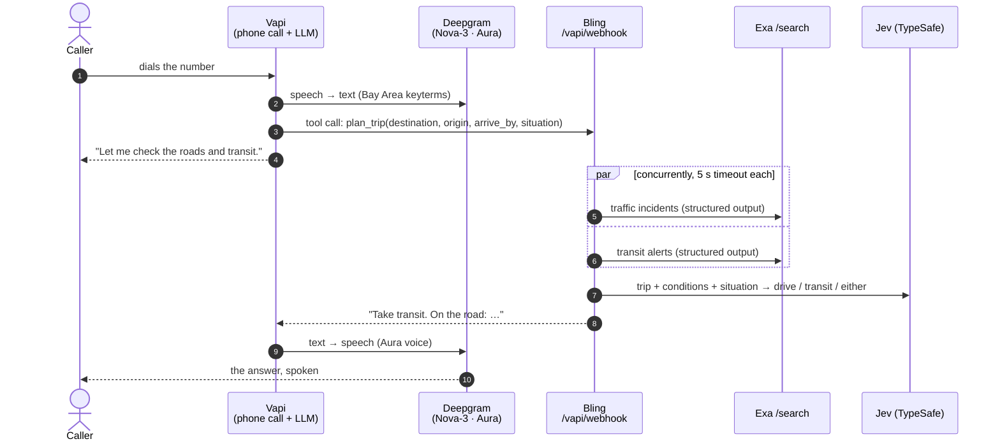

<div align="center">

# 🚦 Bling

**Call a phone number, say where you're going, and hear whether to drive or take transit.**

📞 **Call [(510) 347-7094](tel:+15103477094)** · 🌐 [bling-wheat.vercel.app](https://bling-wheat.vercel.app)

It's a phone call: no app, no texting, no sign-up.

Live Bay Area traffic and transit conditions · a decision model makes the call · all by voice


</div>

---

## What it sounds like (an example call)

> 📞 **Bling:** Hey, it's Bling. Where are you headed?
>
> 🧑 **You:** Salesforce Transit Center, from Oakland. I need to be there by six.
>
> 📞 **Bling:** Let me check the roads and transit.
>
> 📞 **Bling:** Take transit. There's a crash blocking two lanes on the Bay Bridge approach, and
> BART is running normally.

Mention your circumstances ("I've got two suitcases", "I'm with my kids", "parking is a
nightmare there") and Bling takes them into account.

## How it works



| Piece | Job |
|---|---|
| **[Vapi](https://vapi.ai)** | Runs the call: the phone number, turn-taking, interruptions, the conversation LLM, and calling Bling's one tool through a webhook. |
| **[Deepgram](https://deepgram.com)** | Vapi's ears and voice. Nova-3 transcription is boosted with 24 Bay Area **keyterms** (BART, Caltrain, I-880, Salesforce Transit Center…), with 300 ms endpointing for short answers like "SFO". It speaks with an Aura voice, and usage is billed to your own Deepgram key through a Vapi credential. |
| **[Exa](https://exa.ai)** | Two concurrent `/search` calls with a JSON `output_schema`: today's traffic incidents and today's transit alerts, each tagged *minor / moderate / severe*. |
| **Jev ([TypeSafe](https://typesafe.ai))** | A decision model that answers typed questions about a state: a `Choice` for the mode, plus `Noul` probabilities for "traffic is bad" and "transit is disrupted". |

## Design choices

- **Code never picks a verdict.** If Jev is unavailable, errors or times out, Bling says
  *"I couldn't make the call right now"* and still reports the conditions it found.
- **Never invents conditions.** A failed or slow search is marked as missing ("I couldn't check
  traffic"); it never fills in guesses. Items that don't match the schema are dropped.
- **A hard time limit.** The whole `plan_trip` call has an 8 s budget. Exa gets 5 s per search
  and Jev gets 2.5 s with SDK retries off, so the caller is never left waiting.
- **Built to be spoken.** Replies are at most 320 characters, plain sentences, no URLs or lists:
  the verdict first, then the worst road issue, then the worst transit issue.
- **Private by default.** The webhook checks a shared secret with `hmac.compare_digest`. Logs
  record tool names, timings, mode and missing searches, never transcripts, phone numbers or
  keys. `vapi-sync --dry-run` masks every secret, and Vapi error messages are scrubbed of keys.

## Quickstart

```sh
git clone https://github.com/ziadgit/bling && cd bling
uv sync
cp .env.example .env        # add your keys (see below)

.venv/bin/bling ask "Salesforce Transit Center" --from Oakland --by 6pm
.venv/bin/bling ask SFO --situation "two big suitcases" --say reply.mp3   # hear the Aura voice
.venv/bin/bling ask SFO --audio me.m4a     # Deepgram transcribes your recording as the situation
```

Without Exa or TypeSafe keys, `ask` still runs; it just tells you what it couldn't check or decide.

## Put it on a phone number

1. Fill in `.env`: Exa, TypeSafe, Deepgram and Vapi keys, plus a webhook secret
   (`openssl rand -hex 32`).
2. Host the webhook. Either deploy to Vercel (`vercel deploy --prod`; `api/index.py` is the
   entrypoint, and you set the keys with `vercel env add`), or run `bling serve` behind
   `cloudflared tunnel --url http://localhost:8000`. Put the https URL in `PUBLIC_BASE_URL`.
3. `bling vapi-sync --dry-run` to review the assistant, then `bling vapi-sync` to create it.
   Add the printed `VAPI_ASSISTANT_ID` to `.env` (later runs update it in place).
4. Try it in the browser with **Talk to Assistant** in the Vapi dashboard.
5. Vapi dashboard → **Phone Numbers → Create → Free Vapi Number** (area code 415, 628 or 510).
   Set **Inbound Settings → Assistant** to Bling, and call it.

## Configuration

| Variable | Default | |
|---|---|---|
| `EXA_API_KEY`, `TYPESAFE_API_KEY`, `DEEPGRAM_API_KEY`, `VAPI_API_KEY` | — | service keys |
| `VAPI_SERVER_SECRET` | — | shared secret Vapi sends in `x-bling-secret` |
| `PUBLIC_BASE_URL` | — | https URL that reaches `bling serve` |
| `VAPI_ASSISTANT_ID` | — | printed by the first `vapi-sync` |
| `VAPI_VOICE_ID` | `asteria` | Deepgram Aura voice used on calls |
| `VAPI_LLM_PROVIDER` / `VAPI_LLM_MODEL` | `openai` / `gpt-4.1` | Vapi's conversation model |
| `JEV_MODEL` | `jev-1.13.0` | |
| `DEEPGRAM_STT_MODEL` / `DEEPGRAM_TTS_MODEL` | `nova-3` / `aura-2-thalia-en` | for the CLI |
| `BLING_REGION` | `San Francisco Bay Area, CA` | scopes the searches |

## Project layout

```
src/bling/
  conditions.py   Exa searches → Conditions (incidents, alerts, sources, missing)
  decision.py     Jev questions → Recommendation (no verdict when Jev is unavailable)
  pipeline.py     plan_trip() under one deadline, reply_text() for speech
  vapi.py         webhook tool handling, assistant definition, KEYTERMS, Vapi REST client
  deepgram.py     direct STT/TTS, for testing hearing and speaking from the CLI
  app.py          FastAPI: POST /vapi/webhook, GET /healthz, GET / (landing page)
  landing.py      the landing page, inline HTML
  cli.py          bling ask | serve | vapi-sync
  *_test.py       tests beside the code
```

```sh
.venv/bin/ruff check . && .venv/bin/pytest -q    # 37 tests, no network: respx + fakes
```

## How it was built

Bling was built at a hackathon by Claude Code, working from a written spec in a timed session.
[`SPEC.md`](SPEC.md) is the single source of truth, and [`fix_plan.md`](fix_plan.md) is the
backlog, worked top to bottom with one commit per item ([`PROMPT.md`](PROMPT.md) is the
session prompt, [`AGENT.md`](AGENT.md) collects the gotchas). The first build (7 items) took
about 5 minutes of a 27-minute time box. Revision 2, which made Bling voice-only, took about
3 more. The git history shows each step.

To rebuild it yourself: `claude --dangerously-skip-permissions "$(cat PROMPT.md)"`. That flag
runs every command without asking, so use it only in a fresh clone.
